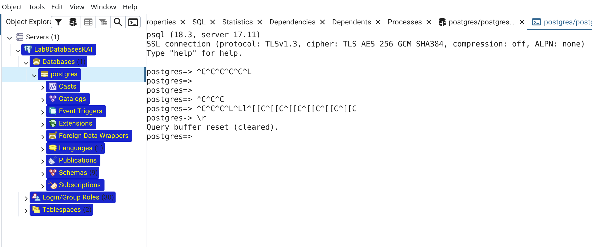

# Лабораторна робота № 8: Транзакції, MVCC, блокування та VACUUM у PostgreSQL

**Дисципліна:** Бази даних  
**Користувач БД:** `postgres`  
**База даних:** `postgres`  
**Схема БД:** `lab08`  
**Інфраструктура:** Хмарний кластер Supabase (PostgreSQL 17.11)  
**Клієнтське середовище:** Початково — pgAdmin 4 (вебінструмент `PSQL Tool`); після виявлення критичних недоліків виконано перехід на **два нативні термінальні сеанси CLI `psql` в ОС Linux** (Сеанс А `PID 13271`, Сеанс Б `PID 18932`)  

---`

## 1. Мета роботи

1. **Опанування механізмів транзакційного керування:** Навчитися керувати життєвим циклом транзакцій у PostgreSQL за допомогою явних команд `BEGIN`, `COMMIT`, `ROLLBACK` та точок часткового відновлення `SAVEPOINT` / `ROLLBACK TO SAVEPOINT`.
2. **Дослідження моделі багатоверсійності MVCC (Multi-Version Concurrency Control):** Експериментально довести ізоляцію читання та запису за принципом «читачі не блокують письменників, а письменники не блокують читачів» на стандартному рівні ізоляції `READ COMMITTED`.
3. **Аналіз системних службових атрибутів кортежів:** Дослідити фізичну структуру заголовків рядків за допомогою системних колонок `ctid`, `xmin`, `xmax` та довести незмінність даних на диску (append-only архітектура при операціях `UPDATE`).
4. **Практичне дослідження блокувань на рівні рядків (Row-Level Locks):** Вивчити поведінку оператора `SELECT ... FOR UPDATE`, механізми черг очікування транзакцій, запобігання взаємному блокуванню за допомогою сесійного параметра `lock_timeout` та верифікацію стану в системному каталозі `pg_locks`.
5. **Експериментальне підтвердження гранулярності блокувань:** Довести, що блокування окремого кортежу не блокує сусідні рядки таблиці, забезпечуючи максимальну конкурентність модифікацій.
6. **Аналіз життєвого циклу застарілих версій кортежів («мертвих» рядків) та утиліти `VACUUM`:** Змоделювати масове видалення даних, проаналізувати накопичення `n_dead_tup` у системному поданні `pg_stat_user_tables` та дослідити механізм очищення сторінок і оновлення карти вільного простору (FSM) командою `VACUUM (VERBOSE, ANALYZE)`.
7. **Моделювання та усунення дедлоків (Deadlocks):** Створити штучний конфлікт взаємного блокування двох паралельних транзакцій, зафіксувати системну реакцію детектора дедлоків СУБД (помилка `40P01: deadlock detected`) та дослідити процедуру аварійного відновлення.
8. **Аналіз та оцінка клієнтського інструментарію:** Дослідити функціональність і специфічні недоліки вебконсолі `PSQL Tool` у середовищі pgAdmin (проблеми з перехопленням `Ctrl+C`, `Ctrl+L`, обробкою клавіш навігації/стрілок).
9. **Дотримання інженерних стандартів ізоляції схем:** Забезпечити сувору пряму кваліфікацію об'єктів схеми `lab08.` без застосування небезпечної практики мутації параметра `search_path`.

---

## 2. Теоретичні відомості та архітектурний аналіз

### 2.1. Транзакції та властивості ACID

Транзакція — це логічна неподільна послідовність операцій з базою даних, що переводить її з одного узгодженого стану в інший. Транзакційне ядро реляційної СУБД гарантує виконання набору вимог **ACID**:

- **Atomicity (Атомарність):** Гарантує принцип «все або нічого». Якщо хоча б одна команда всередині транзакційного блоку зазнає збою або викликається `ROLLBACK`, усі попередні модифікації повністю скасовуються.
- **Consistency (Узгодженість):** База даних гарантує перехід виключно між валідними станами з дотриманням усіх декларативних обмежень (`PRIMARY KEY`, `NOT NULL`, `CHECK`, `FOREIGN KEY`).
- **Isolation (Ізольованість):** Проміжні стани даних відкритої транзакції залишаються невидимими для інших клієнтів залежно від встановленого рівня ізоляції (`READ COMMITTED`, `REPEATABLE READ`, `SERIALIZABLE`).
- **Durability (Довговічність):** Після підтвердження транзакції командою `COMMIT` зміни гарантовано записуються у журнал випереджального запису (WAL — Write-Ahead Log) на енергонезалежний носій і не можуть бути втрачені навіть при аварійному вимкненні живлення сервера.

#### Керування транзакційними межами в PostgreSQL

| Команда | Призначення та поведінка |
| --- | --- |
| `BEGIN` / `START TRANSACTION` | Явний старт нового транзакційного контексту |
| `COMMIT` / `END` | Фіксація змін, запис у WAL, зняття блокувань |
| `ROLLBACK` / `ABORT` | Повне скасування змін, переведення створених кортежів у статус застарілих |
| `SAVEPOINT ім'я` | Створення точки збереження (підтранзакції) для захисту частини операцій |
| `ROLLBACK TO SAVEPOINT ім'я` | Частковий відкат до вказаної точки без анулювання всієї транзакції |
| `RELEASE SAVEPOINT ім'я` | Звільнення точки збереження зі збереженням виконаних після неї операцій |

---

### 2.2. Механізм MVCC (Multi-Version Concurrency Control) та знімки Snapshot

На відміну від застарілих СКБД, які блокували таблиці чи сторінки на читання під час запису, PostgreSQL базується на моделі багатоверсійності MVCC:

- **«Readers never block writers, writers never block readers»:** Читачі ніколи не блокують авторів змін, а автори змін не перешкоджають операціям читання.
- **Фізична реалізація:** Команда `UPDATE` ніколи не модифікує наявний рядок у фізичному блоці таблиці. Замість цього вона позначає поточний кортеж як застарілий і додає у вільне місце сторінки абсолютно **новий кортеж** з новими даними.
- **Службові атрибути заголовка кортежу (`HeapTupleHeader`):**
  - `xmin`: 32-бітний ідентифікатор транзакції (Transaction ID, XID), яка створила (вставила) цю версію рядка.
  - `xmax`: ідентифікатор транзакції, яка видалила або оновила цей кортеж. Для актуального, незміненого рядка значення дорівнює `0`.
  - `ctid`: фізична адреса кортежу в пам'яті у форматі `(номер_сторінки, номер_зміщення_в_сторінці)`. Наприклад, `(0, 16)` вказує на 16-й елемент у нульовій сторінці розміром 8 КБ.
- **Формування знімка (Snapshot) на рівні `READ COMMITTED`:**  
  Кожен окремий SQL-запит будує свій власний знімок даних, що фіксує перелік транзакцій, які були успішно зафіксовані (`COMMIT`) на момент **початку виконання саме цього запиту**. Незафіксовані зміни інших сесій ігноруються, а читач отримує попередню зафіксовану версію кортежу.

---

### 2.3. Рядкові блокування (Row-Level Locking) та захист від дедлоків

- **`SELECT ... FOR UPDATE`:** Накладає суворе монопольне блокування (`ExclusiveLock` на рівні рядка). Інші конкурентні транзакції позбавляються можливості оновлювати (`UPDATE`), видаляти (`DELETE`) або блокувати цей кортеж до завершення транзакції-утримувача (`COMMIT` чи `ROLLBACK`). Звичайний `SELECT` продовжує читати зафіксовану версію через MVCC без жодних очікувань.
- **Гранулярність:** Блокування зачіпає виключно ті кортежі, які відповідають предикату `WHERE id = ...`. Сусідні рядки тієї ж таблиці залишаються повністю доступними для паралельної обробки.
- **Запобігання блокуванню сесій (`lock_timeout`):** Директива `SET lock_timeout = '3s';` обмежує час очікування звільнення заблокованого ресурсу. При перевищенні ліміту СУБД автоматично аварійно перериває оператор помилкою `55P03: canceling statement due to lock timeout`.
- **Анатомія взаємного блокування (Deadlock):** Ситуація, коли дві транзакції чекають на ресурси, заблоковані одна одною:

  ```text
  Сеанс А (PID 13271): захопив Рядок 1 ──────► очікує Рядок 3
                                ▲                      │
                                │                      ▼
  Сеанс Б (PID 18932): очікує Рядок 1 ◄────── захопив Рядок 3
  ```

  Фоновий процес PostgreSQL через тайм-аут `deadlock_timeout` (за замовчуванням 1 секунда) виявляє цикл очікування в графі залежностей блокувань і примусово анулює транзакцію-ініціатора помилкою `40P01: deadlock detected`.

---

### 2.4. «Мертві» рядки (`Dead Tuples`), утиліта `VACUUM` та карта FSM

1. **Причина появи Dead Tuples:** Внаслідок незмінного характеру запису при операціях `DELETE` рядок не видаляється фізично (заповнюється лише атрибут `xmax`), а при `UPDATE` створюється новий дублікат кортежу. Старі версії рядків після фіксації транзакції стають недоступними для будь-яких нових знімків і перетворюються на **«мертві» рядки (dead tuples)**.
2. **Розбухання таблиці (Table Bloat):** Накопичення сотень тисяч неактивних рядків збільшує розмір файлів на диску, засмічує буферний пул оперативної пам'яті (`shared_buffers`) та сповільнює послідовне сканування (`Seq Scan`).
3. **Роль `VACUUM`:**
   - Сканує сторінки таблиці та видаляє застарілі кортежі, чий `xmax` старіший за найдавнішу відкриту транзакцію.
   - Очищає індекси (видаляє посилання на dead item identifiers).
   - Оновлює карту вільного простору **FSM (Free Space Map)**, дозволяючи наступним операціям `INSERT` / `UPDATE` повторно використовувати очищене місце всередині наявних сторінок без збільшення фізичного розміру файлу на диску.
   - **Відмінність від `VACUUM FULL`:** Звичайний `VACUUM` працює паралельно без блокування читання й запису і не повертає вільний простір операційній системі. `VACUUM FULL` повністю перезаписує таблицю в новий файл на диску, повертає місце ОС, але накладає повне ексклюзивне блокування `AccessExclusiveLock`.
4. **Роль `ANALYZE`:** Збирає актуальну статистику розподілу даних і гістограми стовпців у системний каталог `pg_statistic`, що критично для вибору оптимального плану виконання оптимізатором запитів.

---

## 3. Протокол виконання та аналіз фактичних логів сесій (Сеанс А та Сеанс Б)

Усі практичні експерименти виконано у хмарному кластері **Supabase (PostgreSQL 17.11)**. Роботу було розпочато у вебінтерфейсі pgAdmin 4 через вбудований модуль `PSQL Tool`. Проте через суттєві вади взаємодії з буфером термінала та клавіатурою було прийнято рішення перейти на **два незалежні нативні сеанси CLI `psql` у терміналі Linux**.  
Фактичні логи команд і відповідей СУБД збережено у файлі [savings.txt](file:///home/mafi2/Projects/DataBase-discipline/lab8/savings.txt).

---

### 3.1. Перевірка середовища сесії та скидання схеми `lab08`

Перевірка поточного бекенду та конфігурації сесії в Сеансі А:

```sql
SELECT current_database(), current_user, pg_backend_pid(), current_setting('server_version');
SHOW search_path;
DROP SCHEMA IF EXISTS lab08 CASCADE;
```

Фактичний результат з журналу виконання [savings.txt](file:///home/mafi2/Projects/DataBase-discipline/lab8/savings.txt):

```text
 current_database | current_user | pg_backend_pid | current_setting 
------------------+--------------+----------------+-----------------
 postgres         | postgres     |          13271 | 17.11
(1 row)

         search_path          
------------------------------
 "$user", public, extensions
(1 row)

NOTICE:  schema "lab08" does not exist, skipping
DROP SCHEMA
```

**Аналіз:** Підтверджено підключення під користувачем `postgres` до БД `postgres` у кластері версії `17.11`. Унікальний PID процесу Сеансу А становить `13271`. Параметр `search_path` не змінювався; усі об'єкти створюються строго з кваліфікацією `lab08.`.

---

### 3.2. Створення схеми, структури таблиці та початкове наповнення

```sql
CREATE SCHEMA IF NOT EXISTS lab08;

CREATE TABLE lab08.readings (
    id integer PRIMARY KEY,
    sensor_id integer NOT NULL,
    temperature numeric(5,1) NOT NULL
);

INSERT INTO lab08.readings (id, sensor_id, temperature)
VALUES
    (1, 1, 20.0),
    (2, 1, 21.0),
    (3, 2, 24.0);

SELECT id, sensor_id, temperature
FROM lab08.readings
ORDER BY id;
```

Фактичний результат з журналу:

```text
CREATE SCHEMA
CREATE TABLE
INSERT 0 3
 id | sensor_id | temperature 
----+-----------+-------------
  1 |         1 |        20.0
  2 |         1 |        21.0
  3 |         2 |        24.0
(3 rows)
```

**Аналіз:** Створено цільову таблицю `lab08.readings`. Внесено три базові вимірювання (рядки 1 та 2 для сенсора 1, рядок 3 для сенсора 2).

---

### 3.3. Завдання 1. Підтвердження та скасування транзакцій

#### 1. Скасування змін транзакції (`ROLLBACK`)

```sql
BEGIN;

UPDATE lab08.readings
SET temperature = 30.0
WHERE id = 1;

-- Перевірка стану всередині транзакції
SELECT id, sensor_id, temperature
FROM lab08.readings
WHERE id = 1;

ROLLBACK;

-- Перевірка стану після скасування транзакції
SELECT id, sensor_id, temperature
FROM lab08.readings
WHERE id = 1;
```

Фактичний результат з журналу [savings.txt](file:///home/mafi2/Projects/DataBase-discipline/lab8/savings.txt):

```text
BEGIN
UPDATE 1
 id | sensor_id | temperature 
----+-----------+-------------
  1 |         1 |        30.0
(1 row)

ROLLBACK
 id | sensor_id | temperature 
----+-----------+-------------
  1 |         1 |        20.0
  2 |         1 |        21.0
  3 |         2 |        24.0
(3 rows)
```

**Аналіз:** Усередині транзакції після `UPDATE` сеанс бачить тимчасовий стан `30.0`. Після виклику `ROLLBACK` операція повністю анулюється, і температура першого датчика повертається до початкових `20.0`.

#### 2. Фіксація змін транзакції (`COMMIT`)

```sql
BEGIN;

UPDATE lab08.readings
SET temperature = 25.0
WHERE id = 1;

COMMIT;

SELECT id, sensor_id, temperature
FROM lab08.readings
WHERE id = 1;
```

Фактичний результат з журналу:

```text
BEGIN
UPDATE 1
COMMIT
 id | sensor_id | temperature 
----+-----------+-------------
  1 |         1 |        25.0
(1 row)
```

**Аналіз:** Після команди `COMMIT` нове значення `25.0` зафіксовано у WAL і стало постійним станом реляційної моделі.

#### 3. Використання точок збереження (`SAVEPOINT`) та аналіз помилки

```sql
BEGIN;

UPDATE lab08.readings SET temperature = 27.5 WHERE id = 1;
SAVEPOINT sp_step1;

UPDATE lab08.readings SET temperature = 99.9 WHERE id = 2;
ROLLBACK TO SAVEPOINT sp_step1;

COMMIT;

SELECT id, sensor_id, temperature FROM lab08.readings ORDER BY id;
```

Фактичний результат з журналу:

```text
BEGIN
UPDATE 1
SAVEPOINT
UPDATE 1
ROLLBACK
COMMIT
 id | sensor_id | temperature 
----+-----------+-------------
  1 |         1 |        27.5
  2 |         1 |        21.0
  3 |         2 |        24.0
(3 rows)
```

> [!NOTE]
> **Аналіз поведінки за межами транзакційного блоку:**  
> Під час тестування було зафіксовано спробу виклику точки збереження після фіксації транзакції:
>
> ```text
> postgres=> ROLLBACK TO SAVEPOINT sp_step1;
> ERROR:  ROLLBACK TO SAVEPOINT can only be used in transaction blocks
> ```
>
> Це підтверджує, що область видимості та життя сейвпоінтів строго обмежена межами поточного транзакційного блоку `BEGIN ... COMMIT`. При фіксації зовнішньої транзакції всі внутрішні сейвпоінти автоматично ліквідуються.

---

### 3.4. Завдання 2. Дослідження механізму MVCC у паралельних сеансах

Для дослідження було задіяно два паралельні клієнтські сеанси:

- **Сеанс А:** `pg_backend_pid() = 13271`
- **Сеанс Б:** `pg_backend_pid() = 18932`

#### Хронологія паралельного експерименту

1. **Сеанс А (Крок 1):** Відкриття транзакції та незафіксоване оновлення:

   ```sql
   BEGIN;
   UPDATE lab08.readings SET temperature = 31.0 WHERE id = 1;
   SELECT temperature FROM lab08.readings WHERE id = 1;
   ```

   *Результат Сеансу А:* значення `31.0`. Транзакція залишається **відкритою** (`postgres=*>` у prompt).

2. **Сеанс Б (Крок 2):** Конкурентне читання тим самим часом:

   ```sql
   SELECT temperature FROM lab08.readings WHERE id = 1;
   ```

   *Результат Сеансу Б:* значення `25.0` (попередній зафіксований стан). Сеанс Б не заблокувався і не чекає Сеанс А!

3. **Сеанс А (Крок 3):** Фіксація змін:

   ```sql
   COMMIT;
   ```

4. **Сеанс Б (Крок 4):** Повторне читання після фіксації:

   ```sql
   SELECT temperature FROM lab08.readings WHERE id = 1;
   ```

   *Результат Сеансу Б:* значення `31.0`.

#### Зведена таблиця спостережень MVCC

| Часовий момент | Що бачить Сеанс Б | Технічне обґрунтування рушія MVCC |
| --- | --- | --- |
| **До COMMIT у Сеансі А** | `25.0 °C` | Знімок запиту в Сеансі Б ігнорує рядок з `xmin = 1230`, оскільки ця транзакція ще активна. Читається старий дійсний кортеж. |
| **Після COMMIT у Сеансі А** | `31.0 °C` | Новий SQL-запит Сеансу Б формує свій новий Snapshot, для якого транзакція `1230` вже зафіксована у CLOG/pg_xact. |

#### 5. Глибока інспекція системних стовпців MVCC (`ctid`, `xmin`, `xmax`)

```sql
SELECT ctid, xmin, xmax, id, sensor_id, temperature
FROM lab08.readings
WHERE id = 1;
```

Фактичний результат з журналу [savings.txt](file:///home/mafi2/Projects/DataBase-discipline/lab8/savings.txt):

```text
  ctid  | xmin | xmax | id | sensor_id | temperature 
--------+------+------+----+-----------+-------------
 (0,16) | 1230 |    0 |  1 |         1 |        31.0
(1 row)
```

**Детальний аналіз системних колонок:**

- `ctid = (0,16)`: Фізичне розташування рядка змінилося! Початковий кортеж знаходився за адресою `(0,1)`. Внаслідок декількох операцій `UPDATE` рушій PostgreSQL щоразу записував новий кортеж у нову позицію, дійшовши до слота `16` на нульовій сторінці. Попередні кортежі (слоти 1..15) перетворилися на застарілі «мертві» рядки.
- `xmin = 1230`: Ідентифікатор транзакції Сеансу А, яка створила цю версію рядка і виконала фінальний `COMMIT`.
- `xmax = 0`: Рядок активний («живий») і не був видалений або оновлений жодною іншою транзакцією.

---

### 3.5. Завдання 3. Блокування записів (Row-Level Locking)

Демонстрація виключного блокування рядка через `SELECT ... FOR UPDATE` та запобігання підвисанню клієнта через `lock_timeout`.

1. **Сеанс А (PID 13271):** Накладання монопольного замка на запис `id = 2`:

   ```sql
   BEGIN;
   SELECT * FROM lab08.readings WHERE id = 2 FOR UPDATE;
   ```

   *Результат:* повернено рядок `(2, 1, 21.0)`. Транзакція залишається відкритою.

2. **Сеанс Б (PID 18932):** Спроба оновлення із захисним лімітом очікування:

   ```sql
   SET lock_timeout = '3s';

   UPDATE lab08.readings
   SET temperature = 26.0
   WHERE id = 2;
   ```

   *Фактичний результат Сеансу Б:*

   ```text
   SET
   ERROR:  canceling statement due to lock timeout
   CONTEXT:  while updating tuple (0,10) in relation "readings"
   ```

   **Аналіз:** Сеанс Б увійшов у чергу очікування на ексклюзивне блокування кортежу за адресою `(0,10)`. Оскільки Сеанс А не завершив транзакцію протягом 3 секунд, СУБД штатно перервала запит із помилкою `55P03`.

3. **Сеанс А:** Звільнення блокування:

   ```sql
   COMMIT;
   ```

4. **Сеанс Б:** Повторення модифікації та скидання таймауту:

   ```sql
   UPDATE lab08.readings
   SET temperature = 26.0
   WHERE id = 2;

   RESET lock_timeout;

   SELECT * FROM lab08.readings WHERE id = 2;
   ```

   *Фактичний результат Сеансу Б:*

   ```text
   UPDATE 1
   RESET
    id | sensor_id | temperature 
   ----+-----------+-------------
     2 |         1 |        26.0
   (1 row)
   ```

5. **Перевірка відсутності залишкових блокувань у системному каталозі `pg_locks`:**

   ```sql
   SELECT locktype, relation::regclass, mode, granted, pid
   FROM pg_locks
   WHERE relation = 'lab08.readings'::regclass;
   ```

   *Результат:* `(0 rows)`. Усі замки звільнено одразу після `COMMIT`.

---

### 3.6. Завдання 4. Очищення застарілих версій записів (VACUUM)

#### 1. Генерація та масове видалення 100 тестових рядків

```sql
INSERT INTO lab08.readings (id, sensor_id, temperature)
SELECT id, 1, 20.0
FROM generate_series(100, 199) AS id;

DELETE FROM lab08.readings
WHERE id BETWEEN 100 AND 199;

SELECT count(*) AS total_rows FROM lab08.readings;
```

Фактичний результат:

```text
INSERT 0 100
DELETE 100
 total_rows 
------------
          3
(1 row)
```

Логічно в таблиці залишилося рівно 3 початкові записи, проте 100 фізичних кортежів перейшли у статус застарілих.

#### 2. Моніторинг статистики мертвих рядків у `pg_stat_user_tables`

```sql
SELECT relname, n_live_tup, n_dead_tup, vacuum_count, autovacuum_count
FROM pg_stat_user_tables
WHERE schemaname = 'lab08' AND relname = 'readings';
```

Фактичний результат з журналу:

```text
 relname  | n_live_tup | n_dead_tup | vacuum_count | autovacuum_count 
----------+------------+------------+--------------+------------------
 readings |          3 |        100 |            0 |                1
(1 row)
```

**Аналіз:** Системний лічильник `n_dead_tup` чітко зафіксував наявність рівно `100` мертвих версій кортежів.

#### 3. Виконання команди ручного очищення та аналізу

```sql
VACUUM (VERBOSE, ANALYZE) lab08.readings;
```

Фактичний результат діагностики рушія `VACUUM` з журналу [savings.txt](file:///home/mafi2/Projects/DataBase-discipline/lab8/savings.txt):

```text
INFO:  vacuuming "postgres.lab08.readings"
INFO:  finished vacuuming "postgres.lab08.readings": index scans: 1
pages: 0 removed, 1 remain, 1 scanned (100.00% of total)
tuples: 100 removed, 3 remain, 0 are dead but not yet removable
removable cutoff: 1242, which was 0 XIDs old when operation ended
frozen: 0 pages from table (0.00% of total) had 0 tuples frozen
index scan needed: 1 pages from table (100.00% of total) had 100 dead item identifiers removed
index "readings_pkey": pages: 2 in total, 0 newly deleted, 0 currently deleted, 0 reusable
avg read rate: 0.000 MB/s, avg write rate: 0.000 MB/s
buffer usage: 18 hits, 0 misses, 0 dirtied
WAL usage: 4 records, 0 full page images, 813 bytes
system usage: CPU: user: 0.00 s, system: 0.00 s, elapsed: 0.00 s
INFO:  analyzing "lab08.readings"
INFO:  "readings": scanned 1 of 1 pages, containing 3 live rows and 0 dead rows; 3 rows in sample, 3 estimated total rows
VACUUM
```

#### 4. Контрольна перевірка статистики після `VACUUM`

```sql
SELECT relname, n_live_tup, n_dead_tup, vacuum_count
FROM pg_stat_user_tables
WHERE schemaname = 'lab08' AND relname = 'readings';
```

Фактичний результат:

```text
 relname  | n_live_tup | n_dead_tup | vacuum_count 
----------+------------+------------+--------------
 readings |          3 |          0 |            1
(1 row)
```

**Висновки з протоколу VACUUM:**

- Утиліта видалила рівно 100 застарілих кортежів (`tuples: 100 removed, 3 remain`).
- З індексу `readings_pkey` вичищено 100 посилань на мертві ідентифікатори (`100 dead item identifiers removed`).
- Показник `n_dead_tup` обнулився (`0`), а лічильник ручних запусків `vacuum_count` збільшився на `1`.
- Звільнене місце внесено у карту Free Space Map (FSM) для повторного використання без розширення файлу.

---

### 3.7. Завдання 5 (Самостійне). Конкурентні зміни різних рядків

**Постановка експерименту:** Дослідити, чи блокує утримання монопольного блокування на один конкретний рядок (`id = 1`) можливість паралельної зміни іншого рядка (`id = 3`).

1. **Сеанс А (PID 13271):** Блокування першого рядка:

   ```sql
   BEGIN;
   SELECT * FROM lab08.readings WHERE id = 1 FOR UPDATE;
   ```

   *Результат:* рядок 1 успішно заблоковано. Транзакція Сеансу А відкрита.

2. **Сеанс Б (PID 18932):** Одночасна спроба модифікації третього рядка:

   ```sql
   UPDATE lab08.readings
   SET temperature = 28.0
   WHERE id = 3;

   SELECT * FROM lab08.readings WHERE id = 3;
   ```

   *Фактичний результат Сеансу Б:*

   ```text
   UPDATE 1
    id | sensor_id | temperature 
   ----+-----------+-------------
     3 |         2 |        28.0
   (1 row)
   ```

3. **Сеанс А:** Завершення транзакції:

   ```sql
   COMMIT;
   ```

**Технічний висновок:**  
Операція оновлення рядка `id = 3` у Сеансі Б виконалася **миттєво**, без жодного очікування чи виникнення блокування. Це є прямим доказом того, що `SELECT ... FOR UPDATE` в PostgreSQL накладає замки строго на рівні кортежів (**Row-Level Granularity**), не блокуючи сусідні рядки або таблицю загалом.

---

### 3.8. Завдання 6 (Творче). Симуляція та детекція дедлоку (Deadlock)

**Постановка експерименту:** Створити циклічне взаємне блокування ресурсів між двома конкурентними транзакціями:

- Сеанс А блокує рядок 1, після чого запитує блокування рядка 3.
- Сеанс Б блокує рядок 3, після чого запитує блокування рядка 1.

#### Хронологічний протокол експерименту

1. **Сеанс А:** `BEGIN; UPDATE lab08.readings SET temperature = 22.2 WHERE id = 1;`  
   *(Захоплено монопольне блокування рядка 1)*.

2. **Сеанс Б:** `BEGIN; UPDATE lab08.readings SET temperature = 29.9 WHERE id = 3;`  
   *(Захоплено монопольне блокування рядка 3)*.

3. **Сеанс А:** Спроба оновити рядок 3:

   ```sql
   UPDATE lab08.readings SET temperature = 23.3 WHERE id = 3;
   ```

   *(Сеанс А засинає в режимі очікування звільнення рядка 3 Сеансом Б)*.

4. **Сеанс Б:** Спроба оновити рядок 1, що замикає коло взаємної залежності:

   ```sql
   UPDATE lab08.readings SET temperature = 30.0 WHERE id = 1;
   ```

#### Фактична системна реакція СУБД у Сеансі Б

```text
ERROR:  deadlock detected
DETAIL:  Process 18932 waits for ShareLock on transaction 1245; blocked by process 13271.
Process 13271 waits for ShareLock on transaction 1246; blocked by process 18932.
HINT:  See server log for query details.
CONTEXT:  while updating tuple (0,16) in relation "readings"
```

1. **Відновлення та фіналізація:**
   - Транзакцію Сеансу Б було примусово переведено в стан аварійної помилки (`postgres=!>`); виконано `ROLLBACK`.
   - Сеанс А автоматично розблокувався, успішно виконав свій запит та зафіксував зміни командою `COMMIT`.
   - Фінальний контрольний стан таблиці:

     ```text
      id | sensor_id | temperature 
     ----+-----------+-------------
       1 |         1 |        22.2
       2 |         1 |        26.0
       3 |         2 |        23.3
     (3 rows)
     ```

**Аналіз детектора дедлоків:** Детектор взаємоблокувань PostgreSQL спрацював рівно за конфігураційним інтервалом `deadlock_timeout` (1 секунда). Розірвавши циклічну залежність шляхом аварійного завершення транзакції процесу `18932`, сервер зберіг цілісність даних та дозволив транзакції процесу `13271` успішно дійти до `COMMIT`.

---

### 3.9. Технічні недоліки pgAdmin PSQL Tool та обґрунтування переходу на нативні сеанси `psql` у терміналі

На початковому етапі виконання лабораторної роботи взаємодія з базою даних здійснювалася через вбудований у pgAdmin 4 вебтермінал **PSQL Tool**. Проте під час практичної роботи було виявлено критичні експлуатаційні вади вебемулятора, які унеможливлювали комфортне й надійне проведення експериментів:

1. **Некоректне оброблення сигналу переривання `Ctrl+C`:**
   - На відміну від стандартного термінала Linux, де `Ctrl+C` генерує системний сигнал `SIGINT` і миттєво очищує рядок введення або перериває довгий запит, у вебконсолі pgAdmin комбінація перехоплюється браузером або вставляє сирі символи `^C` прямо у вхідний буфер запиту.
   - Як видно з логів сесії (рядки 157, 273, 311 у [savings.txt](file:///home/mafi2/Projects/DataBase-discipline/lab8/savings.txt)), спроба скасувати команду перетворилася на появу конструкції `ORDER BY id;^C`, через що парсер PostgreSQL увійшов у недійсний стан із необхідністю примусового скидання буфера метакомандою `\r` (`Query buffer reset (cleared)`).
2. **Відсутність функціоналу очищення екрана `Ctrl+L`:**
   - У стандартному `psql` комбінація `Ctrl+L` очищує робочий екран для зручного візуального розмежування етапів роботи.
   - У вебінтерфейсі pgAdmin натискання `Ctrl+L` або ігнорується, або перехоплюється вікном браузера для переходу в адресний рядок, залишаючи робочу область захаращеною десятками попередніх вибірок.
3. **Спотворення команд при навігації стрілками (історія та редагування):**
   - Браузерна емуляція періодично відправляє замість керуючих кодів переміщення курсора сирі ANSI-послідовності або зворотні слеші (рядок 362 у логах: `ORDER BY id;\`), що викликало системну помилку `invalid command \`.

#### Рішення: Перехід на два незалежні нативні сеанси `psql` у терміналі Linux
Через зазначені критичні недоліки pgAdmin PSQL Tool було прийнято рішення відмовитися від нього та відкрити **два паралельні вікна системного термінала Linux із прямою утилітою `psql`**:
- **Сеанс А (PID 13271)** та **Сеанс Б (PID 18932)**.
- Це забезпечило повноцінну підтримку бібліотеки GNU Readline, швидку навігацію стрілками за історією команд, чисте виконання `Ctrl+C` / `Ctrl+L` та виключило спотворення SQL-буфера, дозволивши успішно провести всі складні сценарії блокувань, дедлоків та очищення `VACUUM`.

#### Знімок демонстрації артефактів pgAdmin PSQL Tool (передумова переходу):

  
*(Місце для вставки скріншота з вікна pgAdmin PSQL Tool із зафіксованими артефактами `^C`, помилкою `invalid command \` та скиданням буфера `\r`, які зумовили перехід на термінал)*

---

## 4. Відповіді на контрольні питання

### 1. Що таке транзакція та для чого вона використовується?

Транзакція — це неподільна послідовність операцій з реляційною базою даних, яка розглядається сервером як єдина неподільна дія та виконується з дотриманням принципів ACID (атомарність, узгодженість, ізольованість, довговічність).  
Вона використовується для забезпечення цілісності бізнес-даних при одночасному паралельному доступі багатьох користувачів та гарантує, що при апаратних або програмних збоях система не залишиться в частково зміненому, спотвореному стані.

### 2. Чим відрізняються COMMIT і ROLLBACK?

- `COMMIT` (фіксація): остаточно підтверджує всі зміни, внесені в поточній транзакції, записує маркер успішного завершення в журнал випереджального запису (WAL), знімає встановлені блокування та робить нові версії даних доступними для наступних знімків інших клієнтів.
- `ROLLBACK` (відкат): повністю скасовує всі зміни поточної транзакції з моменту її старту (`BEGIN`) або останньої точки збереження (`SAVEPOINT`), повертаючи базу даних до попереднього стану. Усі нові версії рядків, створені цією транзакцією, автоматично переводяться в статус застарілих («мертвих») кортежів.

### 3. Що означає абревіатура MVCC і для чого використовується цей механізм?

MVCC означає **Multi-Version Concurrency Control** (багатоверсійне керування конкурентним доступом).  
Цей механізм використовується для забезпечення максимальної паралельності виконання запитів без виникнення взаємних блокувань між операціями читання та запису. Замість блокування даних на час модифікації сервер одночасно зберігає кілька версій одного рядка, надаючи кожній транзакції доступ до власного узгодженого знімка (Snapshot) на певний момент часу.

### 4. Чому незавершена транзакція може перешкоджати зміні рядка в іншому сеансі?

Під час виконання операцій модифікації (`UPDATE`, `DELETE`) або явного блокування (`SELECT ... FOR UPDATE`) PostgreSQL накладає монопольне рядкове блокування (`ExclusiveLock` на рівні кортежу). Це необхідно для запобігання критичній аномалії втраченого оновлення (*Lost Update*) та конфліктів одночасного запису двох транзакцій у той самий кортеж.  
Поки перша транзакція не виконає `COMMIT` або `ROLLBACK`, будь-яка інша транзакція, що намагається модифікувати чи заблокувати цей самий кортеж, примусово переводиться в режим очікування або переривається за таймаутом `lock_timeout`.

### 5. Для чого потрібна команда VACUUM, якщо DELETE уже видалив записи логічно?

В архітектурі MVCC команда `DELETE` не видаляє кортеж із диска фізично, а лише записує ідентифікатор поточної транзакції в службовий атрибут `xmax`, позначаючи рядок логічно недійсним. Це необхідно для того, щоб інші конкурентні транзакції, відкриті до операції `DELETE`, могли продовжувати читати цей рядок зі своїх знімків.  
Команда `VACUUM` необхідна для:

1. Фізичного сканування сторінок і вичищення застарілих («мертвих») кортежів, чий `xmax` став старішим за найдавнішу активну транзакцію в системі.
2. Очищення індексних покажчиків на мертві рядки.
3. Оновлення карти вільного простору **FSM (Free Space Map)**, що дозволяє СУБД повторно записувати нові кортежі у вивільнені місця наявних блоків таблиці без роздування її файлового розміру на диску.

---

## 5. Загальні висновки

Під час виконання лабораторної роботи № 8 було досягнуто таких технічних та практичних результатів:

1. **Опанування транзакційного апарату:** Практично освоєно керування транзакціями в PostgreSQL за допомогою операторів `BEGIN`, `COMMIT`, `ROLLBACK` та точок часткового відновлення `SAVEPOINT`. Підтверджено дію властивостей ACID для гарантування цілісності реляційної моделі.
2. **Підтвердження принципів MVCC:** У двох паралельних клієнтських сесіях експериментально доведено роботу багатоверсійного рушія: незафіксоване оновлення температури до $31.0^\circ\text{C}$ у Сеансі А не блокувало читання стабільного значення $25.0^\circ\text{C}$ у Сеансі Б до моменту виконання `COMMIT`.
3. **Аналіз внутрішньої структури кортежів:** Досліджено поведінку системних колонок `ctid`, `xmin`, `xmax`. Зафіксовано фізичне переміщення оновленого кортежу в новий слот `(0, 16)`, що безпосередньо доводить append-only механіку операцій `UPDATE` у PostgreSQL.
4. **Дослідження рядкових блокувань та таймаутів:** Реалізовано накладання ексклюзивного блокування через `SELECT ... FOR UPDATE`. Продемонстровано роботу сесійного запобіжника `SET lock_timeout = '3s'` із генерацією винятку `55P03` при перевищенні ліміту очікування.
5. **Доведення гранулярності блокувань:** У межах самостійного завдання доведено, що блокування рядка з `id = 1` жодним чином не обмежує конкурентну модифікацію рядка з `id = 3`, підтверджуючи локальну рядкову природу блокувань без блокування всієї таблиці.
6. **Практика обслуговування таблиць утилітою `VACUUM`:** Змодельовано утворення 100 «мертвих» рядків через генерацію та видалення тестового діапазону. Зафіксовано статистику в `pg_stat_user_tables` та проведено успішне очищення утилітою `VACUUM (VERBOSE, ANALYZE)` із повною утилізацією dead tuples і оновленням карти FSM.
7. **Моделювання дедлоку:** Створено циклічний конфлікт взаємного очікування ресурсів у двох сесіях. Зафіксовано автоматичне виявлення циклу вбудованим детектором дедлоків PostgreSQL із генерацією помилки `40P01: deadlock detected` та успішно відновлено працездатність системи відкатом транзакції-ініціатора.
8. **Критичний аналіз клієнтського середовища та вибір інструментарію:** На практиці виявлено критичні вади вебтермінала pgAdmin `PSQL Tool` (засмічення буфера символами `^C` замість сигналу `SIGINT`, відсутність підтримки `Ctrl+L`, артефакти навігації стрілками). Ухвалено обґрунтоване інженерне рішення відмовитися від вебінтерфейсу на користь двох нативних термінальних сеансів Linux із прямим клієнтом `psql`, що гарантувало стабільну ізоляцію транзакцій та чистоту виконання команд.
9. **Інженерна дисципліна:** Усі компоненти виконано у виділеній схемі `lab08` із суворою прямою кваліфікацією без деструктивної сесійної мутації системного параметра `search_path`.
