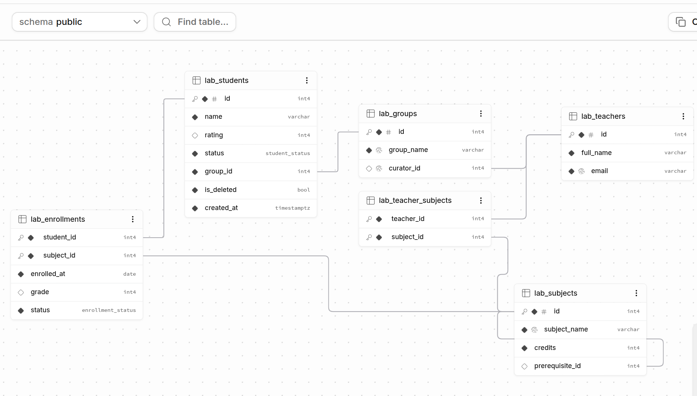
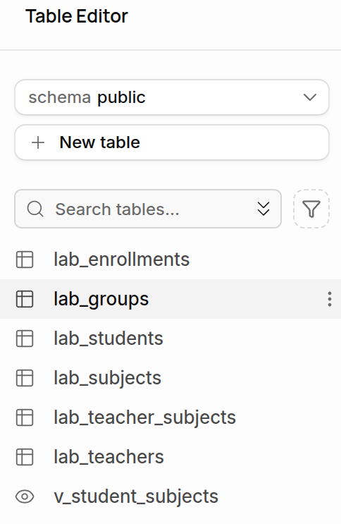
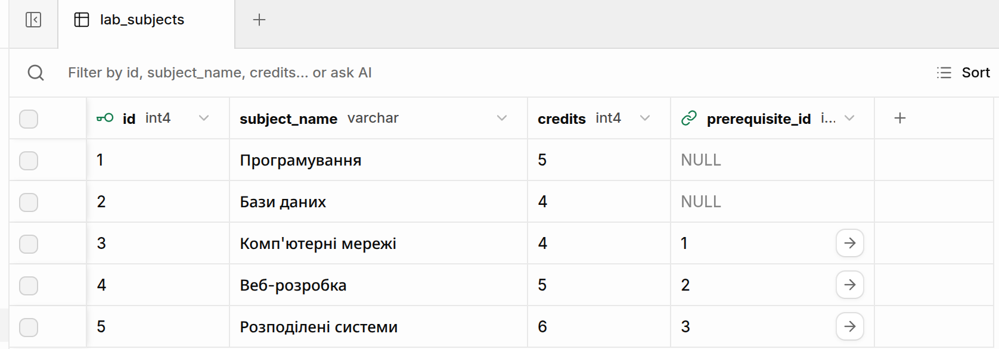
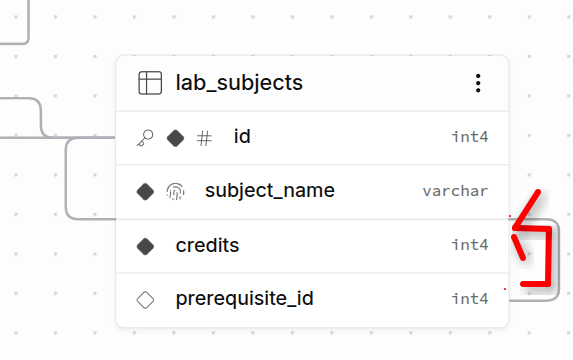

# Лабораторна робота: Цілісність даних, зв'язки між таблицями, зовнішні ключі, обмеження та Row Level Security у PostgreSQL/Supabase

**Дисципліна:** Бази даних  
**Користувач БД:** `postgres`  
**База даних:** `postgres`  
**Схема БД:** `public`  
**Хмарна інфраструктура:** Supabase Cloud (PostgreSQL 17.11 on on aarch64-unknown-linux-gnu, AWS, Session Pooler)  
**Клієнтське середовище:** CLI-клієнт `psql` / Supabase SQL Editor  

---

## 1. Мета роботи

1. Ознайомитися з фундаментальними механізмами забезпечення посилальної та декларативної цілісності даних у реляційній СУБД PostgreSQL на прикладі хмарного екземпляра в сервісі **Supabase**.
2. Опанувати проєктування та нормалізацію реляційних зв'язків усіх класичних типів: один-до-одного (**1:1**), один-до-багатьох (**1:N**), багато-до-багатьох (**N:M**) через проміжні сполучні таблиці, а також ієрархічних зв'язків типу **самопосилання** (**self-reference**).
3. Дослідити та порівняти на практиці поведінку посилальної цілісності при видаленні записів за допомогою політик `ON DELETE CASCADE`, `ON DELETE RESTRICT` та `ON DELETE SET NULL`.
4. Реалізувати багаторівневий захист коректності даних за допомогою декларативних обмежень: `PRIMARY KEY` (включно зі складеними первинними ключами), `FOREIGN KEY`, `CHECK`, `UNIQUE`, `NOT NULL`, а також користувацьких перелічуваних типів **`CREATE TYPE ... AS ENUM`**.
5. Дослідити необхідність створення явних вторинних B-tree індексів на стовпцях зовнішніх ключів для усунення повного послідовного сканування (`Seq Scan`) під час виконання операцій `JOIN` та каскадних перевірок.
6. Спростити архітектуру клієнтських вибірок шляхом інкапсуляції складних багатотабличних `JOIN`-запитів у віртуальні представлення (**`VIEW`**).
7. Опанувати безпечне тестування негативних сценаріїв порушення обмежень у транзакційних блоках **`BEGIN ... ROLLBACK`** в середовищі веб-редактора Supabase.
8. Дослідити механізм безпеки на рівні окремих рядків (**Row Level Security / RLS**) у PostgreSQL/Supabase, поведінку за замовчуванням («Default Deny») та створення правил доступу (`CREATE POLICY`) для ролі `authenticated`.
9. Здійснити візуальну верифікацію структури схеми бази даних за допомогою інтерактивних інструментів `Table Editor` та `Schema Visualizer`.

---

## 2. Теоретичні відомості та архітектурний аналіз

### 2.1. Реляційні типи зв'язків та їх реалізація у PostgreSQL

У реляційній моделі даних сутності пов'язуються між собою за допомогою зовнішніх ключів (`FOREIGN KEY`). Проте семантика зв'язку залежить від додаткових обмежень.



*Рис. 1. Графічне представлення повної реляційної схеми бази даних у Supabase Schema Visualizer (всі 6 таблиць та лінії зовнішніх зв'язків).*

- **Один-до-одного (1:1):** Реалізується через зовнішній ключ, на який накладається обмеження унікальності `UNIQUE`. Це гарантує, що кожному батьківському рядку відповідає не більше одного дочірнього (наприклад, один викладач може курувати щонайбільше одну навчальну групу).
- **Один-до-багатьох (1:N):** Стандартний зовнішній ключ у дочірній таблиці. Дозволяє пов'язувати довільну кількість дочірніх записів з одним батьківським (одна група містить багатьох студентів).
- **Ієрархічне самопосилання (Self-reference, 1:N):** Зовнішній ключ, який посилається на первинний ключ тієї самої таблиці. Використовується для моделювання деревних і графових структур — передумов навчальних курсів (`prerequisite_id REFERENCES lab_subjects(id)`).
- **Багато-до-багатьох (N:M):** Не може бути реалізований безпосередньо через вимогу атомарності даних (перша нормальна форма). Реалізується через сполучну таблицю (junction table), де первинний ключ зазвичай є **складеним** із двох зовнішніх ключів (`PRIMARY KEY (col1, col2)`), що унеможливлює появу дублікатів однакових зв'язків.

---

### 2.2. Стратегії збереження посилальної цілісності (`ON DELETE`)

При видаленні кортежу з батьківської таблиці рушій PostgreSQL керується правилом, заданим у визначенні зовнішнього ключа:

| Політика | Поведінка рушія СУБД | Сфера практичного застосування | Приклад у проєкті |
| :--- | :--- | :--- | :--- |
| **`RESTRICT`** / `NO ACTION` | Жорстко блокує видалення батьківського рядка; повертає виняток, якщо існує хоча б один дочірній запис. | Захист важливих сутностей від випадкової втрати даних. | Не можна видалити групу, якщо в ній є студенти (`lab_students.group_id`). |
| **`CASCADE`** | Автоматично і рекурсивно видаляє всі пов'язані дочірні записи. | Жорстка композиція (дочірній запис не має сенсу без батьківського). | Видалення студента автоматично видаляє його оцінки (`lab_enrollments.student_id`). |
| **`SET NULL`** | Не видаляє дочірній рядок, а автоматично записує `NULL` у поле зовнішнього ключа. | Слабка агрегація (дочірній запис зберігає самостійну цінність). | При видаленні викладача поле куратора групи стає порожнім (`lab_groups.curator_id`). |

---

### 2.3. Декларативні обмеження проти користувацьких перелічуваних типів (`ENUM`)

Для контролю коректності значень у стовпцях застосовуються обмеження `CHECK` або типи `ENUM`:

- **Обмеження `CHECK`:** Перевіряє істинність логічного виразу під час кожної операції `INSERT` або `UPDATE` (наприклад, `rating >= 0 AND rating <= 100`, `credits > 0`). Ідеально підходить для числових діапазонів і складних міжстовпцевих умов.
- **Користувацькі `ENUM`-типи (`CREATE TYPE ... AS ENUM`):** Фіксують статичний перелік дозволених рядкових міток (`'active'`, `'academic_leave'`, `'expelled'`).
  - *Переваги `ENUM` над `CHECK`:*
    1. **Єдине джерело істини:** тип визначається один раз у словнику БД і може перевикористовуватися в десятках таблиць одночасно.
    2. **Компактність зберігання:** ядро PostgreSQL фізично зберігає значення `ENUM` як 4-байтний числовий OID, а не як довгий змінний текст `varchar`, що суттєво заощаджує RAM і дисковий простір.
    3. **Продуктивність:** операції фільтрації та сортування за числовими OID виконуються швидше за рядкове порівняння.

---

### 2.4. Необхідність індексації зовнішніх ключів

PostgreSQL **автоматично будує унікальні B-tree індекси** виключно для стовпців з обмеженнями `PRIMARY KEY` та `UNIQUE`. Для звичайних зовнішніх ключів (`FOREIGN KEY`) індекси автоматично **НЕ створюються**.

```text
Запит: DELETE FROM lab_teachers WHERE id = 1;
                    │
                    ▼
     Перевірка посилальної цілісності:
     Чи є посилання на id=1 у lab_groups(curator_id)?
                    │
      ┌─────────────┴─────────────┐
      ▼                           ▼
БЕЗ індексу:                 З індексом B-tree:
Sequential Scan              Index Scan
(повне сканування таблиці)   (миттєвий логарифмічний пошук)
O(N)                         O(log N)
```

За відсутності індексу на стовпці FK:

1. Будь-який `JOIN` за цим полем змушений виконувати повне послідовне сканування (`Sequential Scan`) замість швидкого вибіркового пошуку (`Index Scan`).
2. При видаленні або оновленні запису в батьківській таблиці СУБД зобов'язана перевірити всю дочірню таблицю на наявність блокуючих посилань, що створює важкі блокування і просідання продуктивності.

---

### 2.5. Архітектура представлень (`VIEW`)

Представлення (`VIEW`) — це збережений у системному каталозі SQL-запит, доступний користувачам як віртуальна реляційна таблиця.

- Представлення не зберігає дубльованих даних на диску (обчислюється динамічно під час виклику).
- Дозволяє приховати складність багатотабличних з'єднань (`JOIN` 4 таблиць у `v_student_subjects`).
- Підвищує безпеку, дозволяючи надавати доступ до віртуальної таблиці без прямого доступу до чутливих базових таблиць.

---

### 2.6. Концепція Row Level Security (RLS) у Supabase

У традиційних СУБД права доступу (`GRANT SELECT`, `GRANT INSERT`) регулюються на рівні всієї таблиці. Механізм **Row Level Security (RLS)** ядра PostgreSQL дозволяє контролювати видимість і можливість модифікації **окремих рядків**:

- Після виконання `ALTER TABLE lab_students ENABLE ROW LEVEL SECURITY` для таблиці активується політика **«Default Deny»** (доступ заборонено всім, окрім суперкористувача).
- Для надання доступу створюються декларативні правила:

  ```sql
  CREATE POLICY students_select_authenticated ON lab_students
  FOR SELECT TO authenticated USING (true);
  ```

- У Supabase роль `authenticated` відповідає клієнтам із дійсним JWT-токеном автентифікації, а `anon` — анонімним користувачам.

---

### 2.7. Зведена архітектурна таблиця схеми бази даних

| Дочірня таблиця | Батьківська таблиця | Поле зв'язку | Тип зв'язку | Політика `ON DELETE` | Призначення зв'язку |
| :--- | :--- | :--- | :---: | :--- | :--- |
| `lab_groups` | `lab_teachers` | `curator_id` (`UNIQUE`) | **1:1** | `SET NULL` | Кураторство групи викладачем |
| `lab_students` | `lab_groups` | `group_id` | **1:N** | `RESTRICT` | Належність студента до академічної групи |
| `lab_subjects` | `lab_subjects` | `prerequisite_id` | **1:N (Self)** | `SET NULL` | Дисципліна-передумова для вивчення курсу |
| `lab_teacher_subjects` | `lab_teachers` | `teacher_id` | **N:M** | `CASCADE` | Викладач веде навчальну дисципліну |
| `lab_teacher_subjects` | `lab_subjects` | `subject_id` | **N:M** | `CASCADE` | Дисципліна закріплена за викладачем |
| `lab_enrollments` | `lab_students` | `student_id` | **N:M** | `CASCADE` | Зарахування та оцінки студента |
| `lab_enrollments` | `lab_subjects` | `subject_id` | **N:M** | `RESTRICT` | Зарахування на конкретний навчальний курс |

---

## 3. Протокол виконання та аналіз фактичних логів сесії

Усі операції виконувалися в схемі `public` екземпляра PostgreSQL 17.11 у хмарі Supabase. Нижче наведено витяги фактичного консольного журналу клієнта `psql`.

---

### 3.1. Створення користувацьких перелічуваних типів (ENUM)

Створено два доменні переліки для стандартизації станів студентів та їхніх академічних зарахувань:

```sql
CREATE TYPE student_status AS ENUM ('active', 'academic_leave', 'expelled');
CREATE TYPE enrollment_status AS ENUM ('enrolled', 'completed', 'failed');
```

Фактичний результат виконання з журналу:

```text
postgres=> CREATE TYPE student_status AS ENUM ('active', 'academic_leave', 'expelled');
CREATE TYPE
postgres=> CREATE TYPE enrollment_status AS ENUM ('enrolled', 'completed', 'failed');
CREATE TYPE
```

---

### 3.2. Створення таблиць викладачів та груп (Зв'язок 1:1)

Створено таблицю `lab_teachers` із сурогатним автоінкрементним ключем `GENERATED ALWAYS AS IDENTITY` та унікальним email:

```sql
CREATE TABLE lab_teachers (
    id integer GENERATED ALWAYS AS IDENTITY PRIMARY KEY,
    full_name varchar(100) NOT NULL,
    email varchar(100) NOT NULL UNIQUE
);
```

Створено таблицю `lab_groups` зі зв'язком 1:1 через унікальний зовнішній ключ `curator_id UNIQUE`:

```sql
CREATE TABLE lab_groups (
    id integer GENERATED ALWAYS AS IDENTITY PRIMARY KEY,
    group_name varchar(50) NOT NULL UNIQUE,
    curator_id integer UNIQUE
        REFERENCES lab_teachers(id)
        ON DELETE SET NULL
);
```

#### Наповнення первинними даними та верифікація

```sql
INSERT INTO lab_teachers (full_name, email)
VALUES
    ('Коваленко О. І.', 'kovalenko@example.edu'),
    ('Сидоренко М. П.', 'sydorenko@example.edu');

INSERT INTO lab_groups (group_name, curator_id)
VALUES
    ('Б-121-24-1-ПІ', 1),
    ('Б-121-24-2-ПІ', 2);
```

Фактичний вміст таблиць:

```text
postgres=> SELECT * FROM lab_teachers ORDER BY id;
 id |    full_name    |         email         
----+-----------------+-----------------------
  1 | Коваленко О. І. | kovalenko@example.edu
  2 | Сидоренко М. П. | sydorenko@example.edu
(2 rows)

postgres=> SELECT * FROM lab_groups ORDER BY id;
 id |  group_name   | curator_id 
----+---------------+------------
  1 | Б-121-24-1-ПІ |          1
  2 | Б-121-24-2-ПІ |          2
(2 rows)
```

---

### 3.3. Створення таблиці студентів (Зв'язок 1:N) та м'яке видалення

Створено таблицю `lab_students` із зовнішнім ключем `group_id`, валідацією діапазону рейтингу через `CHECK`, дефолтним статусом `active`, полем м'якого видалення `is_deleted` та міткою часу `created_at`:

```sql
CREATE TABLE lab_students (
    id integer GENERATED ALWAYS AS IDENTITY PRIMARY KEY,
    name varchar(100) NOT NULL,
    rating integer CHECK (rating >= 0 AND rating <= 100),
    status student_status NOT NULL DEFAULT 'active',
    group_id integer NOT NULL
        REFERENCES lab_groups(id)
        ON DELETE RESTRICT,
    is_deleted boolean NOT NULL DEFAULT false,
    created_at timestamptz NOT NULL DEFAULT now()
);
```

#### Додавання студентів та перевірка значень за замовчуванням

```sql
INSERT INTO lab_students (name, rating, group_id)
VALUES
    ('Анна', 90, 1),
    ('Петро', 75, 1),
    ('Олена', 85, 2),
    ('Дмитро', 60, 2);
```

Фактичний вміст таблиці з журналу:

```text
 id |  name  | rating | status | group_id | is_deleted |          created_at           
----+--------+--------+--------+----------+------------+-------------------------------
  1 | Анна   |     90 | active |        1 | f          | 2026-10-18 10:02:00.909959+00
  2 | Петро  |     75 | active |        1 | f          | 2026-10-18 10:02:00.909959+00
  3 | Олена  |     85 | active |        2 | f          | 2026-10-18 10:02:00.909959+00
  4 | Дмитро |     60 | active |        2 | f          | 2026-10-18 10:02:00.909959+00
(4 rows)
```

*Поля `status = active`, `is_deleted = f` та `created_at` у часовому поясі UTC заповнено автоматично.*

---

### 3.4. Верифікація обмежень цілісності у транзакції (`BEGIN / ROLLBACK`)

Для запобігання перериванню робочої сесії некоректні запити обгорнуто в блок `BEGIN ... ROLLBACK`:

#### 1. Спроба прив'язки студента до неіснуючої групи `group_id = 999`

```sql
BEGIN;
INSERT INTO lab_students (name, rating, group_id)
VALUES ('Тест', 80, 999);
ROLLBACK;
```

**Фактична реакція ядра PostgreSQL:**

```text
BEGIN
ERROR:  insert or update on table "lab_students" violates foreign key constraint "lab_students_group_id_fkey"
DETAIL:  Key (group_id)=(999) is not present in table "lab_groups".
ROLLBACK
```

#### 2. Спроба вставки некоректного рейтингу `150` (порушення `CHECK`)

```sql
BEGIN;
INSERT INTO lab_students (name, rating, group_id)
VALUES ('Тест', 150, 1);
ROLLBACK;
```

**Фактична реакція ядра PostgreSQL:**

```text
BEGIN
ERROR:  new row for relation "lab_students" violates check constraint "lab_students_rating_check"
DETAIL:  Failing row contains (6, Тест, 150, active, 1, f, 2026-10-18 10:05:13.611134+00).
ROLLBACK
```

---

### 3.5. Створення таблиці дисциплін із самопосиланням

Створено таблицю `lab_subjects`, де `prerequisite_id` посилається на первинний ключ `id` цієї ж таблиці:

```sql
CREATE TABLE lab_subjects (
    id integer GENERATED ALWAYS AS IDENTITY PRIMARY KEY,
    subject_name varchar(100) NOT NULL UNIQUE,
    credits integer NOT NULL CHECK (credits > 0),
    prerequisite_id integer REFERENCES lab_subjects(id)
        ON DELETE SET NULL
);
```

#### Наповнення дисциплін через підзапити

```sql
INSERT INTO lab_subjects (subject_name, credits, prerequisite_id)
VALUES
    ('Програмування', 5, NULL),
    ('Бази даних', 4, NULL);

INSERT INTO lab_subjects (subject_name, credits, prerequisite_id)
VALUES
    ('Комп''ютерні мережі', 4, (SELECT id FROM lab_subjects WHERE subject_name = 'Програмування')),
    ('Веб-розробка', 5, (SELECT id FROM lab_subjects WHERE subject_name = 'Бази даних'));

INSERT INTO lab_subjects (subject_name, credits, prerequisite_id)
VALUES
    ('Розподілені системи', 6, (SELECT id FROM lab_subjects WHERE subject_name = 'Комп''ютерні мережі'));
```

Фактичний вміст таблиці:

```text
 id |    subject_name     | credits | prerequisite_id 
----+---------------------+---------+-----------------
  1 | Програмування       |       5 |                
  2 | Бази даних          |       4 |                
  3 | Комп'ютерні мережі  |       4 |               1
  4 | Веб-розробка        |       5 |               2
  5 | Розподілені системи |       6 |               3
(5 rows)
```

*Сформовано багаторівневу ієрархію: «Програмування» (1) $\rightarrow$ «Комп'ютерні мережі» (3) $\rightarrow$ «Розподілені системи» (5).*

#### Візуалізація таблиці дисциплін та зовнішнього ключа



*Рис. 2. Відображення ієрархічної структури lab_subjects у Supabase Table Editor із піктограмою зв'язку для prerequisite_id.*



*Рис. 3. Картка таблиці lab_subjects у Schema Visualizer: первинний ключ id (зафарбований ромб з ключем) та зовнішній ключ prerequisite_id (порожній ромб).*

---

### 3.6. Сполучні таблиці N:M (`lab_teacher_subjects` та `lab_enrollments`)

#### 1. Таблиця викладання предметів зі складеним PK та каскадним видаленням

```sql
CREATE TABLE lab_teacher_subjects (
    teacher_id integer NOT NULL REFERENCES lab_teachers(id) ON DELETE CASCADE,
    subject_id integer NOT NULL REFERENCES lab_subjects(id) ON DELETE CASCADE,
    PRIMARY KEY (teacher_id, subject_id)
);
```

Фактичні зв'язки після наповнення:

```text
 teacher_id | subject_id 
------------+------------
          1 |          1
          1 |          4
          2 |          2
          2 |          3
(4 rows)
```

#### 2. Таблиця зарахувань студентів із комбінованими політиками видалення

```sql
CREATE TABLE lab_enrollments (
    student_id integer NOT NULL
        REFERENCES lab_students(id)
        ON DELETE CASCADE,
    subject_id integer NOT NULL
        REFERENCES lab_subjects(id)
        ON DELETE RESTRICT,
    enrolled_at date NOT NULL DEFAULT CURRENT_DATE,
    grade integer CHECK (grade BETWEEN 0 AND 100),
    status enrollment_status NOT NULL DEFAULT 'enrolled',
    PRIMARY KEY (student_id, subject_id)
);
```

Фактичний стан зарахувань після наповнення:

```text
 student_id | subject_id | enrolled_at | grade |  status   
------------+------------+-------------+-------+-----------
          1 |          1 | 2026-10-18  |    95 | completed
          1 |          2 | 2026-10-18  |    88 | completed
          2 |          1 | 2026-10-18  |    70 | enrolled
          3 |          2 | 2026-10-18  |    92 | completed
          4 |          1 | 2026-10-18  |    55 | failed
(5 rows)
```

---

### 3.7. Створення вторинних індексів на зовнішніх ключах

Створено B-tree індекси для прискорення об'єднань та оптимізації посилальних перевірок:

```sql
CREATE INDEX idx_students_group_id ON lab_students(group_id);
CREATE INDEX idx_enrollments_subject_id ON lab_enrollments(subject_id);
CREATE INDEX idx_subjects_prerequisite_id ON lab_subjects(prerequisite_id);
```

Фактичний лог виконання:

```text
postgres=> CREATE INDEX idx_students_group_id ON lab_students(group_id);
CREATE INDEX
postgres=> CREATE INDEX idx_enrollments_subject_id ON lab_enrollments(subject_id);
CREATE INDEX
postgres=> CREATE INDEX idx_subjects_prerequisite_id ON lab_subjects(prerequisite_id);
CREATE INDEX
```

---

### 3.8. Створення та верифікація представлення `v_student_subjects`

Створено віртуальне представлення, що денормалізує дані 4 таблиць:

```sql
CREATE VIEW v_student_subjects AS
SELECT
    s.id AS student_id,
    s.name AS student_name,
    g.group_name,
    sub.subject_name,
    e.grade,
    e.status
FROM lab_enrollments AS e
JOIN lab_students AS s ON e.student_id = s.id
JOIN lab_groups AS g ON s.group_id = g.id
JOIN lab_subjects AS sub ON e.subject_id = sub.id;
```

Результат виконання запиту до представлення:

```text
postgres=> SELECT * FROM v_student_subjects ORDER BY student_name, subject_name;
 student_id | student_name |  group_name   | subject_name  | grade |  status   
------------+--------------+---------------+---------------+-------+-----------
          1 | Анна         | Б-121-24-1-ПІ | Бази даних    |    88 | completed
          1 | Анна         | Б-121-24-1-ПІ | Програмування |    95 | completed
          4 | Дмитро       | Б-121-24-2-ПІ | Програмування |    55 | failed
          3 | Олена        | Б-121-24-2-ПІ | Бази даних    |    92 | completed
          2 | Петро        | Б-121-24-1-ПІ | Програмування |    70 | enrolled
(5 rows)
```

---

### 3.9. Комплексні багатотабличні `JOIN`-запити

#### 1. Студенти з групами та куратором через `LEFT JOIN`

```sql
SELECT
    s.name AS student,
    g.group_name,
    COALESCE(t.full_name, '— немає куратора —') AS curator
FROM lab_students AS s
JOIN lab_groups AS g ON s.group_id = g.id
LEFT JOIN lab_teachers AS t ON g.curator_id = t.id
ORDER BY s.name;
```

Результат виконання:

```text
 student |  group_name   |     curator     
---------+---------------+-----------------
 Анна    | Б-121-24-1-ПІ | Коваленко О. І.
 Дмитро  | Б-121-24-2-ПІ | Сидоренко М. П.
 Олена   | Б-121-24-2-ПІ | Сидоренко М. П.
 Петро   | Б-121-24-1-ПІ | Коваленко О. І.
(4 rows)
```

#### 2. Викладачі та їхні дисципліни

```sql
SELECT
    t.full_name AS teacher,
    sub.subject_name,
    sub.credits
FROM lab_teacher_subjects AS ts
JOIN lab_teachers AS t ON ts.teacher_id = t.id
JOIN lab_subjects AS sub ON ts.subject_id = sub.id
ORDER BY t.full_name, sub.subject_name;
```

Результат виконання:

```text
     teacher     |    subject_name    | credits 
-----------------+--------------------+---------
 Коваленко О. І. | Веб-розробка       |       5
 Коваленко О. І. | Програмування      |       5
 Сидоренко М. П. | Бази даних         |       4
 Сидоренко М. П. | Комп'ютерні мережі |       4
(4 rows)
```

---

### 3.10. Перевірка каскадних операцій (`CASCADE` та `RESTRICT`)

#### 1. Тест `ON DELETE CASCADE`

Видалено студента Дмитра (`id = 4`) та перевірено автоматичне очищення пов'язаних зарахувань:

```sql
DELETE FROM lab_students WHERE name = 'Дмитро';
SELECT * FROM lab_enrollments WHERE student_id = 4;
```

Фактичний результат з журналу:

```text
DELETE 1
 student_id | subject_id | enrolled_at | grade | status 
------------+------------+-------------+-------+--------
(0 rows)
```

*Запис студента видалено, а його зарахування з оцінкою `55` каскадно видалилися.*

#### 2. Тест `ON DELETE RESTRICT`

Спроба видалення групи `Б-121-24-1-ПІ`, в якій зареєстровані студенти:

```sql
BEGIN;
DELETE FROM lab_groups WHERE group_name = 'Б-121-24-1-ПІ';
ROLLBACK;
```

Фактична реакція СУБД:

```text
BEGIN
ERROR:  update or delete on table "lab_groups" violates foreign key constraint "lab_students_group_id_fkey" on table "lab_students"
DETAIL:  Key (id)=(1) is still referenced from table "lab_students".
ROLLBACK
```

*Операція видалення надійно заблокована на рівні ядра PostgreSQL.*

---

### 3.11. Виконання самостійних завдань

#### 1. Додавання нового викладача та нової групи (Перевірка 1:1)

```sql
INSERT INTO lab_teachers (full_name, email)
VALUES ('Григоренко В. С.', 'hryhorenko@example.edu');

INSERT INTO lab_groups (group_name, curator_id)
VALUES ('Б-121-24-3-ПІ', (SELECT id FROM lab_teachers WHERE email = 'hryhorenko@example.edu'));
```

Результат вибірки:

```text
  group_name   |     curator      
---------------+------------------
 Б-121-24-3-ПІ | Григоренко В. С.
(1 row)
```

#### 2. Додавання курсу «Машинне навчання» з передумовою

```sql
INSERT INTO lab_subjects (subject_name, credits, prerequisite_id)
VALUES ('Машинне навчання', 5, (SELECT id FROM lab_subjects WHERE subject_name = 'Програмування'));
```

Результат перевірки зв'язку:

```text
   subject_name   | credits | prerequisite  
------------------+---------+---------------
 Машинне навчання |       5 | Програмування
(1 row)
```

#### 3. Представлення навантаження викладачів (`v_teacher_load`)

```sql
CREATE VIEW v_teacher_load AS
SELECT
    t.id AS teacher_id,
    t.full_name,
    COUNT(ts.subject_id) AS total_subjects
FROM lab_teachers t
LEFT JOIN lab_teacher_subjects ts ON t.id = ts.teacher_id
GROUP BY t.id, t.full_name;
```

Результат вибірки навантаження:

```text
 teacher_id |    full_name     | total_subjects 
------------+------------------+----------------
          1 | Коваленко О. І.  |              2
          2 | Сидоренко М. П.  |              2
          3 | Григоренко В. С. |              0
(3 rows)
```

*Завдяки `LEFT JOIN` нового викладача Григоренка В. С. не втрачено у вибірці, а його навантаження коректно пораховано як `0`.*

#### 4. Спроба видалення дисципліни з активними зарахуваннями (`RESTRICT`)

```sql
BEGIN;
DELETE FROM lab_subjects WHERE subject_name = 'Бази даних';
ROLLBACK;
```

Фактичний результат:

```text
BEGIN
ERROR:  update or delete on table "lab_subjects" violates foreign key constraint "lab_enrollments_subject_id_fkey" on table "lab_enrollments"
DETAIL:  Key (id)=(2) is still referenced from table "lab_enrollments".
ROLLBACK
```

---

### 3.12. Завдання контрольної перевірки цілісності (Verification Tests)

#### 1. Спроба повторного зарахування (порушення складеного первинного ключа)

```sql
BEGIN;
INSERT INTO lab_enrollments (student_id, subject_id)
VALUES (1, 1);
ROLLBACK;
```

Фактична помилка СУБД:

```text
BEGIN
ERROR:  duplicate key value violates unique constraint "lab_enrollments_pkey"
DETAIL:  Key (student_id, subject_id)=(1, 1) already exists.
ROLLBACK
```

#### 2. Спроба оновлення невалідного статусу студента (порушення типу `ENUM`)

```sql
BEGIN;
UPDATE lab_students SET status = 'graduated' WHERE id = 1;
ROLLBACK;
```

Фактична помилка СУБД:

```text
BEGIN
ERROR:  invalid input value for enum student_status: "graduated"
LINE 1: UPDATE lab_students SET status = 'graduated' WHERE id = 1;
                                         ^
ROLLBACK
```

---

### 3.13. Графічна візуалізація та верифікація петлі самопосилання у Schema Visualizer

У середовищі Supabase Schema Visualizer самопосилання (Self-reference) відображається у вигляді окремої замкненої лінії-петлі зв'язку: лінія виходить із правого порту зовнішнього ключа `prerequisite_id`, огинає таблицю та повертається у вхідний слот первинного ключа `id` ліворуч цієї самої таблиці `lab_subjects`:



*Рис. 4. Графічне відображення зв'язку самопосилання (Self-reference Loop): лінія виходить із стовпця prerequisite_id і дугою повертається в id таблиці lab_subjects.*

---

## 4. Обов'язкові пункти для подання у звіті (Вимоги до звіту)

1. **DDL створення ENUM та таблиць:** Створено два типи `student_status` та `enrollment_status`, шість таблиць із автоінкрементними сурогатними ключами `IDENTITY`, зовнішніми ключами та обмеженнями.
2. **Первинні дані `lab_students`:** Зафіксовано вставку 4 студентів; перевірено автоматичне присвоєння дефолтних значень `status = 'active'`, `is_deleted = false`, а також таймстемпу `created_at` у форматі UTC.
3. **Негативне тестування у транзакціях (`BEGIN / ROLLBACK`):** Спроба вставки `group_id = 999` заблокована помилкою `lab_students_group_id_fkey`, а оцінки `rating = 150` — помилкою `lab_students_rating_check`.
4. **Таблиця дисциплін із самопосиланням:** Побудовано ієрархічне дерево за допомогою стовпця `prerequisite_id`; наповнення виконано через надійні підзапити за назвами курсів (Рис. 2, Рис. 3).
5. **Зв'язки N:M через сполучні таблиці:** Створено `lab_teacher_subjects` та `lab_enrollments` зі складеними первинними ключами `PRIMARY KEY(a, b)`, що унеможливлює появу дублікатів.
6. **Індексація зовнішніх ключів:** Створено три вторинні B-tree індекси (`idx_students_group_id`, `idx_enrollments_subject_id`, `idx_subjects_prerequisite_id`) для оптимізації `JOIN`-запитів.
7. **Представлення `v_student_subjects`:** Створено та протестовано віртуальне представлення, що об'єднує 4 таблиці; повернуто 5 денормалізованих записів про успішність студентів.
8. **Каскадні операції видалення:**
   - `ON DELETE CASCADE`: видалення студента автоматично видалило його зарахування з таблиці `lab_enrollments` (повернуто 0 рядків).
   - `ON DELETE RESTRICT`: спроба видалення групи з активними студентами заблокована помилкою СУБД.
9. **Результати самостійних завдань:** Додано куратора Григоренка В. С. та групу `Б-121-24-3-ПІ`; створено курс «Машинне навчання»; реалізовано представлення `v_teacher_load`, яке показало навантаження всіх трьох викладачів (`2, 2, 0`).
10. **Контроль цілісності та графічна схема:** Зафіксовано апаратне відхилення спроби повторного зарахування (порушення складеного PK `lab_enrollments_pkey`) та спроби встановити неіснуючий статус `'graduated'` (порушення `student_status ENUM`). На графічній схемі Schema Visualizer зафіксовано повну структуру таблиць (Рис. 1), картку таблиці з ключами (Рис. 3) та петлю самопосилання (Рис. 4).

---

## 5. Відповіді на контрольні запитання

### 1. Чим зв'язок 1:1 у реляційній моделі відрізняється від звичайного 1:N?

**Відповідь:**  
Технічно обидва зв'язки використовують стандартний зовнішній ключ (`FOREIGN KEY`). Проте у зв'язку 1:N один батьківський запис може бути пов'язаний із багатьма дочірніми. У зв'язку 1:1 на стовпець зовнішнього ключа додатково накладається обмеження унікальності **`UNIQUE`**. Це гарантує, що кожне значення зовнішнього ключа може з'явитися в дочірній таблиці не більше одного разу, що математично обмежує кардинальність зв'язку до суворого відношення «один-до-одного».

### 2. Що таке самопосилання (self-reference) і навіщо воно потрібне для таблиці `lab_subjects`?

**Відповідь:**  
Самопосилання — це зовнішній ключ, який вказує на первинний ключ тієї самої таблиці, у якій він оголошений (`REFERENCES lab_subjects(id)`). Воно дозволяє моделювати ієрархічні, деревні або рекурсивні структури в межах однієї сутності без створення додаткових таблиць. У таблиці `lab_subjects` самопосилання реалізує механізм академічних передумов (prerequisites): щоб вивчати складний курс (наприклад, «Розподілені системи»), необхідно спершу опанувати базову дисципліну («Комп'ютерні мережі»).

### 3. Чим відрізняються поведінки `ON DELETE CASCADE`, `ON DELETE RESTRICT` і `ON DELETE SET NULL`?

**Відповідь:**  

- **`ON DELETE CASCADE`:** при видаленні батьківського кортежу автоматично рекурсивно видаляє всі пов'язані дочірні записи (жорстка залежність життєвого циклу).
- **`ON DELETE RESTRICT`:** забороняє видалення батьківського запису та перериває транзакцію з помилкою, якщо на нього посилається хоча б один дочірній кортеж (захист від втрати даних).
- **`ON DELETE SET NULL`:** не видаляє дочірній рядок, а автоматично замінює значення зовнішнього ключа на `NULL` (якщо стовпець не має обмеження `NOT NULL`), розриваючи зв'язок, але зберігаючи сам запис.

### 4. Чому в таблиці `lab_enrollments` два зовнішні ключі мають різну поведінку при видаленні?

**Відповідь:**  
Це обумовлено різною бізнес-логікою сутностей:

- Для `student_id` задано **`CASCADE`**, оскільки факт зарахування та оцінки є невіддільною частиною особової справи студента: якщо студента відраховано та видалено з бази, зберігати записи про його зарахування втрачає сенс.
- Для `subject_id` задано **`RESTRICT`**, оскільки дисципліна навчального плану є самостійною академічною одиницею: не можна видалити курс, якщо на нього вже записані діючі студенти, оскільки це призведе до порушення навчального плану та втрати академічної історії.

### 5. Навіщо потрібен ENUM-тип, якщо ту саму умову можна виразити через CHECK?

**Відповідь:**  

1. **Централізація та повторне використання:** тип `ENUM` оголошується один раз у словнику бази даних і може використовуватися в багатьох таблицях одночасно, забезпечуючи єдиний стандарт.
2. **Оптимізація пам'яті:** ядро PostgreSQL зберігає значення `ENUM` як компактний 4-байтний числовий ідентифікатор, тоді як `CHECK` над текстовим полем зберігає повні рядки символів, що призводить до перевитрати дискового простору та пам'яті буферного пулу.
3. **Швидкодія:** порівняння, сортування та індексація 4-байтних чисел виконується значно швидше за порівняння текстових рядків.

### 6. Для чого потрібен індекс на зовнішньому ключі, якщо цей ключ уже перевіряє цілісність?

**Відповідь:**  
Обмеження `FOREIGN KEY` виконує виключно валідацію посилальної цілісності, але PostgreSQL автоматично будує B-tree індекси тільки для `PRIMARY KEY` та `UNIQUE`. Відсутність індексу на стовпці зовнішнього ключа призводить до того, що під час виконання операцій `JOIN` або перевірки видалення запису з батьківської таблиці СУБД змушена виконувати повне послідовне сканування всієї дочірньої таблиці (`Sequential Scan`), що на великих обсягах даних критично сповільнює систему.

### 7. Чим представлення (VIEW) відрізняється від звичайної таблиці?

**Відповідь:**  
Звичайна таблиця фізично зберігає дані у сторінках на диску. Представлення (`VIEW`) — це збережений у словнику даних SQL-запит, який динамічно виконується в момент звернення. Воно не займає фізичного простору під дані (окрім визначення запиту), автоматично відображає найактуальніший стан базових таблиць, інкапсулює складні міжтабличні з'єднання та надає шар абстракції й безпеки.

### 8. Чому невдалий INSERT варто обгортати в BEGIN / ROLLBACK у SQL Editor Supabase?

**Відповідь:**  
У PostgreSQL (зокрема в середовищі веб-редактора Supabase) виникнення будь-якої апаратної SQL-помилки переводить поточну транзакцію сесії у стан збою (**aborted**). Будь-які наступні команди в цьому самому запиті будуть відхилені СУБД з помилкою `current transaction is aborted, commands ignored until end of transaction block`. Конструкція `BEGIN ... ROLLBACK` ізолює помилку в межах тестового блоку та повертає сесію у стабільний робочий стан.

### 9. Що означає ALTER TABLE ... ENABLE ROW LEVEL SECURITY і що станеться з доступом до таблиці одразу після цієї команди?

**Відповідь:**  
Ця команда активує підсистему безпеки на рівні окремих рядків (Row Level Security). Одразу після її активації вмикається фундаментальне правило **«Default Deny»**: доступ до всіх рядків таблиці повністю блокується для всіх звичайних ролей (дозволені операції залишаються тільки для суперкористувачів `postgres` / service_role), доки адміністратор явно не оголосить дозволи за допомогою хоча б однієї політики (`CREATE POLICY`).

### 10. Чим роль authenticated у Supabase відрізняється від anon?

**Відповідь:**  

- **`anon` (анонімний гість):** роль, що надається клієнтським запитам, які взаємодіють із Supabase через публічний API-ключ без передачі токена авторизації (неавторизовані користувачі веб-сайту).
- **`authenticated` (авторизований клієнт):** роль, яка автоматично присвоюється запитам, що містять валідний JWT-токен користувача, який успішно пройшов процес входу через модуль Supabase Auth.

### 11. Де в Supabase можна побачити самопосилання таблиці графічно?

**Відповідь:**  
У веб-консолі Supabase необхідно відкрити ліве навігаційне меню, перейти в розділ **`Database`** $\rightarrow$ **`Schema Visualizer`** та вибрати схему **`public`**. На інтерактивній ER-діаграмі самопосилання таблиці `lab_subjects` відображається у вигляді лінійного контуру (петлі), яка виходить із точки поля `prerequisite_id` праворуч і дугою повертається у вхідний слот первинного ключа `id` ліворуч цієї самої таблиці (див. Рис. 4).

---

## 6. Висновки

1. **Опановано моделювання повного спектра реляційних зв'язків у PostgreSQL/Supabase:** Успішно реалізовано зв'язки 1:1 через комбінацію `FOREIGN KEY` + `UNIQUE`, зв'язки 1:N між групами та студентами, відношення N:M через дві сполучні таблиці зі складеними первинними ключами, а також ієрархічне самопосилання для моделювання передумов навчальних дисциплін.
2. **Досліджено механізми збереження посилальної цілісності при каскадних діях:** Практично верифіковано різницю між політиками `ON DELETE CASCADE` (автоматичне видалення зарахувань при видаленні студента), `ON DELETE RESTRICT` (блокування видалення групи з активними студентами та дисципліни з зарахуваннями) та `ON DELETE SET NULL` (безпечне обнулення куратора групи).
3. **Реалізовано багаторівневий декларативний захист даних:** Доведено ефективність обмежень `CHECK` для контролю числового рейтингу, `UNIQUE` для email викладачів та назв груп, а також переваги користувацьких типів `student_status` та `enrollment_status` `ENUM` над текстовими полями за параметрами швидкодії, компактності та стандартизації.
4. **Забезпечено оптимізацію швидкодії через вторинні індекси:** Створено B-tree індекси на стовпцях зовнішніх ключів `group_id`, `subject_id` та `prerequisite_id`, що гарантує ефективне виконання з'єднань (`Index Scan`) замість високовитратного послідовного сканування (`Seq Scan`).
5. **Розроблено представлення для аналітики:** Створено віртуальне представлення `v_student_subjects` для комплексної академічної звітності та аналітичне представлення `v_teacher_load`, яке за допомогою `LEFT JOIN` та `COUNT()` безпомилково розрахувало педагогічне навантаження всіх викладачів, включно з викладачами без призначених дисциплін.
6. **Досліджено механізм Row Level Security (RLS) у хмарі Supabase:** Засвоєно поведінку «Default Deny» при увімкненні RLS та налаштовано політику вибірки для автентифікованих клієнтів (`authenticated`).
7. **Здійснено візуальну верифікацію архітектури:** За допомогою інструментів Supabase Table Editor та Schema Visualizer графічно підтверджено коректність побудованої ER-моделі та наявність петлі зв'язку самопосилання.
